# SPEC — Iskra: технічне завдання для AI-агента

Nov 17, 2026 · @Dmytro

Збудуй статичний одноекранний сайт iskra-project.com.ua з реалістичним зоряним небом і кнопкою, що відкриває Google Форму. Джерело вимог — PRD «Iskra: односторінковий сайт»; у разі розбіжностей діє цей SPEC.

## 1. Задача і жорсткі обмеження

Результат — тека `site/`, яку власник копіює в `public_html` на HostiQ без жодної збірки. Робоча тека проєкту: `робимо сайт/` (там уже є `logo/`, `prd/`, `package.json` з `@playwright/cli`).

**Обов'язково:**

- Чистий HTML5 + CSS + vanilla JS (ES2020, `type="module"`). Без фреймворків, бандлерів, CDN і сторонніх runtime-залежностей.
- Усе для рантайму лежить у `site/`; жодних запитів до зовнішніх доменів під час завантаження сторінки (шрифти й дані зірок — локально).
- Одна сторінка `index.html`, мова українська, тексти — дослівно з §3.
- Кнопка працює без JavaScript (звичайне посилання).
- Небо будується з реальних координат зірок; вигадані чи випадкові позиції зірок заборонені.

**Не робити:**

- Не вигадувати URL Google Форми, email, соцмережі чи `entry.*`-ідентифікатори — використовувати плейсхолдери з §11.
- Не змінювати файли в `logo/` і `prd/` — лише копіювати потрібне в `site/`.
- Не додавати секції, меню, cookie-банери, аналітичні скрипти, англійську версію.
- Не деплоїти на хостинг самостійно — лише підготувати архів і інструкцію (§11).

**Порядок роботи:** §2 структура → §5 дані зірок → §3–§4 верстка → §6 небо → §7–§8 → §10 перевірка → §11 архів. Після кожного етапу — скріншот через Playwright і самоперевірка.

## 2. Структура проєкту і асети

Агент створює `site/` (деплой), `scripts/` (інструменти збирання) і `tests/`; шляхи логотипів у `site/` повторюють `logo/`, бо `site.webmanifest` посилається на `/logo/favicon/...`.

```
робимо сайт/
├─ logo/                      ← існує, тільки читати
├─ prd/                       ← існує, тільки читати
├─ scripts/
│  ├─ build-stars.mjs         ← генерує site/data/sky.json (§5)
│  └─ copy-assets.mjs         ← копіює лого, фавікони, шрифти в site/
├─ tests/
│  └─ site.spec.mjs           ← Playwright-перевірки (§10)
├─ site/                      ← ВЕСЬ вміст цієї теки йде в public_html
│  ├─ index.html
│  ├─ styles.css
│  ├─ sky.js
│  ├─ data/sky.json
│  ├─ fonts/manrope-cyrillic.woff2, manrope-latin.woff2
│  ├─ logo/svg/iskra-logo-short-white.svg
│  ├─ logo/favicon/*          ← усі файли з logo/favicon/
│  ├─ logo/social/og-image.png
│  ├─ robots.txt
│  ├─ sitemap.xml
│  ├─ .htaccess
│  └─ CREDITS.txt             ← атрибуція даних зірок і шрифту
└─ dist/iskra-site.zip        ← архів site/ для завантаження
```

| Асет | Джерело | Де використовується |
| --- | --- | --- |
| Логотип без підзаголовка, для темного фону | `logo/svg/iskra-logo-short-white.svg` (viewBox 421×126) | `` у шапці |
| Фавікони і маніфест | `logo/favicon/` (favicon.ico, favicon.svg, favicon-16/32/48.png, apple-touch-icon.png, icon-192/512.png, site.webmanifest) | `<head>` |
| OG-картинка 1200×630 | `logo/social/og-image.png` | `og:image`, `twitter:image` |
| Фірмові кольори | `logo/colors.css` | перенести змінні у `styles.css` (§4) |
| Шрифт Manrope (variable, wght 400–700) | npm `@fontsource-variable/manrope` (devDependency): файли `manrope-cyrillic-wght-normal.woff2`, `manrope-latin-wght-normal.woff2` | `@font-face` у `styles.css` |

Правила логотипа з `logo/README.md`: не розтягувати, не міняти кольори, без тіней, вільне поле ≥ висоти літери «I», мінімальна висота 24 px.

## 3. HTML-розмітка і тексти

`site/index.html` має саме це дерево елементів і саме ці тексти; класи можна перейменувати лише синхронно з тестами. `<head>` описано в §8.

```html
<!doctype html>
<html lang="uk">
<head>… див. §8 …</head>
<body>
  <canvas id="sky" class="sky" aria-hidden="true"></canvas>
  <div class="sky-tooltip" id="sky-tooltip" aria-hidden="true" hidden></div>

  <main class="hero">
    <header class="hero__logo">
      
    </header>

    <h1 class="hero__title">
      Допомагаємо безкоштовно технічними матеріалами і обладнанням гурткам
      з електроніки, робототехніки та блогерам в Україні.
    </h1>

    <p class="hero__text">
      Просимо знімати цікаві й корисні відео на технічну тематику
      для українського YouTube та інших соціальних мереж.
    </p>

    <p class="hero__cta-lead">
      Якщо ви викладач або блогер — перейдіть за посиланням і залиште ваші дані,
      ми обов’язково з вами зв’яжемося.
    </p>

    <a class="cta" id="cta"
       href="__FORM_URL__"
       target="_blank" rel="noopener">Зв’язатися з нами</a>

    <p class="hero__privacy">
      Натискаючи кнопку, ви погоджуєтеся на обробку ваших персональних даних
      (ім’я, телефон, місто) лише для зв’язку з вами щодо проєкту Iskra.
      Ми не передаємо їх третім особам і видалимо на ваш запит.
    </p>
  </main>

  <footer class="footer">© 2026 Iskra · iskra-project.com.ua</footer>

  <noscript><style>.sky{display:none}</style></noscript>
  <script type="module" src="/sky.js"></script>
</body>
</html>
```

- Апостроф у текстах — типографський `’` (U+2019), тире — `—` з пробілами.
- `__FORM_URL__` — єдине місце посилання на форму в усьому проєкті (див. §7, §11).
- Порядок фокусу клавіатурою: єдиний фокусований елемент — кнопка `#cta`.

## 4. Стилі

Усе в одному `site/styles.css`, mobile-first; тема завжди темна (світлої немає).

### 4.1 Токени

```css
:root {
  --iskra-starlight: #BFF6FF;
  --iskra-cyan:      #2EC5E0;
  --iskra-blue:      #6C7CFF;
  --iskra-nebula:    #A78BFA;
  --iskra-night:     #070C24;
  --iskra-ice:       #EEF3FA;
  --iskra-gradient:  linear-gradient(135deg, #2EC5E0 0%, #6C7CFF 55%, #A78BFA 100%);

  --text:        var(--iskra-ice);
  --text-muted:  rgb(238 243 250 / .78);
  --text-faint:  rgb(238 243 250 / .62);
  --content-max: 720px;
  color-scheme: dark;
}
```

### 4.2 Шрифт

```css
@font-face {
  font-family: "Manrope";
  src: url("/fonts/manrope-cyrillic.woff2") format("woff2");
  font-weight: 400 700; font-display: swap;
  unicode-range: U+0301, U+0400-045F, U+0490-0491, U+04B0-04B1, U+2116;
}
@font-face {
  font-family: "Manrope";
  src: url("/fonts/manrope-latin.woff2") format("woff2");
  font-weight: 400 700; font-display: swap;
  unicode-range: U+0000-00FF, U+0131, U+0152-0153, U+02BB-02BC, U+02C6, U+02DA, U+02DC, U+2000-206F, U+20AC, U+2122, U+2191, U+2193, U+2212, U+2215, U+FEFF, U+FFFD;
}
body { font-family: "Manrope", system-ui, -apple-system, "Segoe UI", Roboto, sans-serif; }
```

`<link rel="preload" href="/fonts/manrope-cyrillic.woff2" as="font" type="font/woff2" crossorigin>` у `<head>`.

### 4.3 Layout

| Елемент | Вимоги |
| --- | --- |
| `html, body` | `margin:0; background: var(--iskra-night); color: var(--text); min-height:100%`; `-webkit-font-smoothing: antialiased` |
| `.sky` | `position:fixed; inset:0; width:100%; height:100%; z-index:0; display:block` |
| Фон під canvas (і fallback без JS) | на `body`: `background: radial-gradient(120% 90% at 50% 40%, #0B1433 0%, #070C24 55%, #03050F 100%)` |
| `.hero` | `position:relative; z-index:1; min-height:100svh` (fallback `100vh`); flex column, `align-items:center; justify-content:center; text-align:center`; `gap: clamp(14px, 2.2vh, 24px)`; `padding: 24px 16px 56px`; `max-width: var(--content-max); margin: 0 auto` |
| Затемнення під текстом | `.hero::before`: `position:absolute; inset:-10% -30%; z-index:-1; background: radial-gradient(closest-side, rgb(7 12 36 / .72), rgb(7 12 36 / .45) 55%, transparent 100%); pointer-events:none` |
| `.hero__logo img` | висота `clamp(40px, 7vh, 72px)`, `width:auto`, `display:block` |
| `.hero__title` | `font-weight:700; font-size: clamp(22px, 1.2rem + 1.6vw, 40px); line-height:1.25; letter-spacing:-0.01em; margin:0; text-wrap: balance` |
| `.hero__text` | `font-weight:400; font-size: clamp(16px, .9rem + .4vw, 20px); line-height:1.5; color: var(--text-muted); margin:0` |
| `.hero__cta-lead` | `font-size: clamp(15px, .85rem + .3vw, 18px); line-height:1.5; color: var(--text); margin:0` |
| `.cta` | `display:inline-flex; align-items:center; justify-content:center; min-height:52px; min-width:240px; padding: 14px 32px; border-radius:999px; background: var(--iskra-gradient); color: var(--iskra-night); font-weight:700; font-size:18px; text-decoration:none; box-shadow: 0 0 0 1px rgb(191 246 255 / .25), 0 8px 32px rgb(108 124 255 / .35); transition: transform .15s, box-shadow .2s` |
| `.cta:hover` | `transform: translateY(-1px)`; сяйво `0 0 0 1px rgb(191 246 255 / .5), 0 10px 44px rgb(46 197 224 / .5)` |
| `.cta:active` | `transform: translateY(0) scale(.98)` |
| `.cta:focus-visible` | `outline: 3px solid var(--iskra-starlight); outline-offset: 4px` |
| `.hero__privacy` | `font-size: 13px` (від 768px — `14px`); `line-height:1.45; color: var(--text-faint); max-width: 560px; margin:0` |
| `.footer` | `position:fixed; bottom:12px; left:0; right:0; text-align:center; z-index:1; font-size:12px; color: var(--text-faint); pointer-events:none`; на екранах з `max-height: 640px` — `position:static` і падінг 16px |

### 4.4 Адаптив

- Ширина 320–2560 px без горизонтальної прокрутки (`overflow-x: hidden` на `body` — лише як страховка, не як лікування).
- Десктоп (≥ 1024 × ≥ 700): усе в один екран, вертикальної прокрутки немає.
- Низькі екрани (ландшафт телефона, `max-height: 500px`): прокрутка дозволена, `justify-content: flex-start`, логотип 36 px.
- Контроль: кнопка `#cta` повністю в першому екрані на всіх віевпортах з §10, крім ландшафту телефона.

### 4.5 Рух

```css
@media (prefers-reduced-motion: reduce) {
  *, *::before, *::after { transition: none !important; animation: none !important; }
}
```

Анімацію неба цей режим зупиняє через JS (§6.6).

## 5. Зоряне небо: дані

Дані беруться один раз скриптом `scripts/build-stars.mjs` і комітяться як `site/data/sky.json`; сайт ніколи не ходить по дані в інтернет.

### 5.1 Джерела (BSD-3-Clause, проєкт d3-celestial)

| Файл | URL | Що беремо |
| --- | --- | --- |
| `stars.6.json` | https://raw.githubusercontent.com/ofrohn/d3-celestial/master/data/stars.6.json | усі зірки до 6m: координати, `mag`, `bv` |
| `constellations.lines.json` | https://raw.githubusercontent.com/ofrohn/d3-celestial/master/data/constellations.lines.json | лінії для `UMa`, `UMi`, `Cas`, `Ori`, `Cyg`, `Lyr` |

Резервне джерело, якщо GitHub недоступний: ті самі шляхи через `https://cdn.jsdelivr.net/gh/ofrohn/d3-celestial@master/data/<файл>`.

**Перевірити після завантаження (не припускати):** це GeoJSON `FeatureCollection`; `geometry.coordinates = [lon, lat]`, де `lon` — пряме сходження в градусах у діапазоні −180…180 (RA > 180° збережено як RA − 360), `lat` — схилення. Скрипт нормалізує RA до \[0, 360). Якщо структура інша — адаптувати скрипт і написати про це в звіті.

**Саніті-тест (скрипт падає, якщо не проходить):** у даних є зірка з mag < 2,2 в межах 0,5° від Полярної (RA 37,95°, Dec +89,26°), і зірка з mag < 0,3 в межах 0,5° від Веги (RA 279,23°, Dec +38,78°).

### 5.2 Формат `site/data/sky.json`

```json
{
  "v": 1,
  "stars": [[ra, dec, mag, bv], …],
  "lines": { "UMa": [[[ra, dec], [ra, dec], …], …], "UMi": […], "Cas": […], "Ori": […], "Cyg": […], "Lyr": […] },
  "credits": "Star and constellation data: d3-celestial by Olaf Frohn, BSD-3-Clause"
}
```

- `stars`: лише `mag ≤ 6.0`, відсортовані за `mag` за зростанням (найяскравіші перші — це дозволяє на мобільних просто обрізати масив).
- Усі числа округлені до 2 знаків; `bv` відсутнє або нечислове → `0.6`.
- Очікуваний розмір: ≈ 4 500–5 500 зірок, ≤ 160 КБ без стиснення. Більше — знизити поріг до 5,8m.
- Плеяди окремо не зберігаються: це звичайні зірки з `stars` біля RA 56,75°, Dec +24,12°.

### 5.3 Скрипти

- `node scripts/build-stars.mjs` — Node ≥ 18 (вбудований `fetch`), без залежностей; пише `site/data/sky.json` і додає рядок у `site/CREDITS.txt`.
- `node scripts/copy-assets.mjs` — копіює асети з §2 і woff2 з `node_modules/@fontsource-variable/manrope/files/`.
- Додати в `package.json`: `"build:stars"`, `"build:assets"`, `"serve": "npx http-server site -p 8080 -c-1"`, `"test"`, `"zip"`.

## 6. Зоряне небо: рендер (`site/sky.js`)

Небо — це карта північного неба в стереографічній проекції з центром у Полярній, так як її бачить спостерігач знизу; вона повільно обертається навколо полюса, як справжнє небо.

### 6.1 Проекція

Для зірки (α, δ) у градусах:

```latex
\theta = 90^\circ - \delta \qquad r = k \cdot 2\tan(\theta / 2) \qquad a = \alpha - \varphi(t)
```

```latex
x = P_x + r \sin a \qquad y = P_y - r \cos a
```

- `P` — екранна позиція полюса світу; `k` — масштаб (px); `φ(t)` — кут обертання.
- Пряме сходження зростає **за годинниковою стрілкою** — це вигляд знизу, дзеркальний та вивернутий принаймні сузір'я дадуть форми, які люди не впізнають.
- Зірки з δ < −35° не малювати.
- Обертання: `φ(t) = φ₀ + t · 360° / ROTATION_PERIOD_S`. Збільшення `φ` крутить небо проти годинникової стрілки, як справжнє небо навколо Полярної.

### 6.2 Константи (верх `sky.js`, підлаштовуються за скріншотами)

| Константа | Стартове значення | Сенс |
| --- | --- | --- |
| `POLE_X`, `POLE_Y` | `0.5`, `0.30` (частки ширини / висоти) | де на екрані Полярна |
| `SCALE` | `k = 0.36 · hypot(W, H)` | масштаб карти |
| `PHI0_DEG` | підібрати | початковий поворот: Кассіопея і Велика Ведмедиця — по боках від Полярної, Оріон — праворуч внизу, Лебідь і Ліра — ліворуч |
| `ROTATION_PERIOD_S` | `600` (1 оберт за 10 хв) | швидкість обертання |
| `MAG_LIMIT` | `6.0` десктоп, `5.0` якщо `min(W,H) < 600` | скільки зірок |
| `DPR_MAX` | `2` | стеля `devicePixelRatio` |
| `TWINKLE_SHARE` | `0.25` зірок з mag < 4,5 | хто мерехтить |
| `METEOR_INTERVAL_S` | `[10, 20]` | падаюча зірка |

Ціль підбору: на 1366×768 і 1920×1080 усі 6 сузір'їв і Плеяди цілком у кадрі в момент t = 0, і жодне не лежить центром під блоком тексту (центральна колонка 720 px). На портретному телефоні принаймні 3 сузір'я цілком у кадрі. Якщо одний набір не підходить для всіх екранів — два пресети: landscape і portrait.

### 6.3 Вигляд зірок

- Радіус (CSS px): `r = clamp(0.35, 0.55 · (6.3 − mag), 3.2)`; на ширині < 600 px множити на 0,85.
- Непрозорість: `clamp(0.18, (6.5 − mag) / 5, 1)`.
- Сяйво для `mag < 1.5`: радіальний градієнт радіусом `r · 4`, колір зірки, alpha 0,25 → 0.
- Колір за B−V (лінійна інтерполяція між точками, далі підмішати 25% білого, щоб не було кислотних кольорів):

| B−V | −0,30 | 0,00 | 0,30 | 0,60 | 0,90 | 1,20 | ≥ 1,60 |
| --- | --- | --- | --- | --- | --- | --- | --- |
| RGB | #9BB0FF | #CAD7FF | #F8F7FF | #FFF4EA | #FFE2BE | #FFCC8F | #FFB46B |

### 6.4 Шари та рендер кадру

1. **Статичний шар** (offscreen canvas, перемальовується лише при resize): Чумацький Шлях + усі немерехтливі зірки, у системі координат з центром у полюсі при `φ = 0`. Розмір = `2 · R`, де `R` — відстань від `P` до найдальшого кута екрану.
2. **Кожен кадр:** `ctx.save(); translate(P); rotate(−φ); drawImage(статичний шар)`; у тому ж перетворенні — мерехтливі зірки і лінії сузір'їв; `restore()`; потім метеор у екранних координатах.
3. **Чумацький Шлях:** точки галактичного екватора (b = 0, l = 0…360° кроком 2°) перевести в (α, δ) за формулами нижче; у кожній — радіальна пляма радіусом відповідним ≈ 8° неба, колір почергово `--iskra-nebula` / `--iskra-blue`, alpha 0,035–0,07 з детермінованим шумом (seeded PRNG, напр. mulberry32, seed 7). Найяскравіше біля Лебедя, тьмяніше біля Оріона/Візничника.

```latex
\sin\delta = \cos\delta_G \cos(l_{NCP} - l)
```

```latex
\alpha = \alpha_G + \operatorname{atan2}\big(\sin(l_{NCP} - l),\; -\sin\delta_G \cos(l_{NCP} - l)\big)
```

де α\_G = 192,85948°, δ\_G = 27,12825°, l\_NCP = 122,93192° (J2000).

### 6.5 Сузір'я і взаємодія

| ID | Назва для підказки |
| --- | --- |
| `UMa` | Велика Ведмедиця |
| `UMi` | Мала Ведмедиця |
| `Cas` | Кассіопея |
| `Ori` | Оріон |
| `Cyg` | Лебідь |
| `Lyr` | Ліра |
| Плеяди (коло 1,2° довкола RA 56,75°, Dec +24,12°) | Плеяди |
| зірка біля RA 37,95°, Dec +89,26° | Полярна зірка |

- Лінії: `lineWidth 0.8` CSS px, колір `rgb(191 246 255)`, alpha 0,18. Після завантаження сузір'я «промальовуються» по черзі (кожне 1,2 с, затримка 0,25 с між ними) через `setLineDash` + `lineDashOffset`.
- Наведення — лише для `(hover: hover) and (pointer: fine)`: курсор переводити в систему неба (зворотний поворот); сузір'я, до якого відрізок ближче 14 px, підсвічується (alpha 0,55, за 200 мс), а `#sky-tooltip` показує назву біля курсора (13 px, `--text-muted`, фон `rgb(7 12 36 / .7)`, radius 6 px). Над `.hero` (текстом і кнопкою) підказка не показується. Слухач — на `window`, бо canvas під контентом.
- Мерехтіння: alpha × `1 − A · (0.5 + 0.5 sin(2πt/T + ψ))`, A ∈ \[0,15; 0,35\], T ∈ \[2; 6\] с, ψ — випадкові, але з фіксованим seed.
- Метеор («іскра»): раз на 10–20 с, старт у верхніх 40% екрана поза центральною колонкою, довжина 120–220 px, кут 20–45° вниз, тривалість 0,6–0,9 с, хвіст — лінійний градієнт від `#FFFFFF` (голова) через `--iskra-cyan` до прозорого, товщина 1,5 px.

### 6.6 Життєвий цикл

- Старт: `fetch('/data/sky.json')` → побудова шарів → плавна поява canvas (`opacity 0 → 1` за 800 мс). Помилка завантаження → тихо лишити CSS-фон, без винятків у консолі.
- `requestAnimationFrame`, час — з `performance.now()`; на `visibilitychange` (hidden) — стоп, при поверненні — продовжити без стрибка.
- Resize: debounce 150 мс, перерахувати `W, H, P, k, R` і перемалювати статичний шар. Canvas: `width = W · dpr`, `ctx.setTransform(dpr, 0, 0, dpr, 0, 0)`.
- `prefers-reduced-motion: reduce` (і зміна цього налаштування на льоту): один статичний кадр з усіма лініями, без обертання, мерехтіння, метеорів і без rAF-циклу.
- Для тестів: `?still=1` у URL → такий самий статичний кадр для стабільних скріншотів; `window.__sky = { ready: true, visible: { UMa: true, … } }` після першого кадру, де `visible[id]` = усі точки сузір'я в межах в'юпорту.

## 7. Кнопка, форма, аналітика

Кнопка — звичайне посилання на Google Форму; сайт не збирає і не зберігає жодних даних.

| ID | Вимога | Як перевірити |
| --- | --- | --- |
| FR-1 | `<a id="cta" href="__FORM_URL__" target="_blank" rel="noopener">` — без JS-обробників, що скасовують перехід | з вимкненим JS клік відкриває нову вкладку з цим URL |
| FR-2 | `__FORM_URL__` трапляється рівно один раз у `site/` | `grep -r "__FORM_URL__" site \| wc -l` → 1 |
| FR-3 | Кнопка в першому екрані на віевпортах §10 | Playwright: `boundingBox().y + height ≤ innerHeight` |
| FR-4 | Стани hover / focus-visible / active; зона натискання ≥ 48×48 px | Playwright: розмір боксу; скріншот після `Tab` |
| FR-5 | Клік викликає `track('cta_click')` (див. нижче), не блокуючи перехід | у тесті підмінити `window.plausible` і перевірити виклик |
| FR-6 | Під кнопкою — текст політики з §3, дослівно | порівняння рядка в тесті |

**Аналітика.** Сервіс ще не вибрано (§11), тому скриптів аналітики не підключати. У `sky.js` (або окремому маленькому модулі) додати адаптер, який нічого не робить, поки сервісу немає:

```js
export function track(event) {
  try {
    if (typeof window.plausible === 'function') window.plausible(event);
    else if (typeof window.gtag === 'function') window.gtag('event', event);
  } catch { /* аналітика ніколи не ламає кнопку */ }
}
document.getElementById('cta')?.addEventListener('click', () => track('cta_click'));
```

**Google Форма (створює власник, не агент)** — для довідки, щоб текст політики відповідав полям:

| Поле | Тип | Обов'язкове |
| --- | --- | --- |
| Ім'я | коротка відповідь | ні |
| Хто ви | вибір: викладач / блогер / інше | так |
| Телефон | коротка відповідь (валідація) | так |
| Місто / область | коротка відповідь | так |
| Згода на обробку персональних даних | прапорець | так |

Якщо у формі з'явиться email чи інше поле з персональними даними — перелік у тексті політики (§3) треба оновити синхронно.

## 8. SEO і серверні файли

Канонічна адреса — `https://iskra-project.com.ua/` (HTTPS, без www).

### 8.1 `<head>`

```html
<meta charset="utf-8">
<meta name="viewport" content="width=device-width, initial-scale=1, viewport-fit=cover">
<title>Iskra — технічна допомога гурткам і блогерам</title>
<meta name="description" content="Iskra безкоштовно допомагає технічними матеріалами й обладнанням гурткам з електроніки, робототехніки та блогерам в Україні. Залиште заявку.">
<link rel="canonical" href="https://iskra-project.com.ua/">
<meta name="theme-color" content="#070C24">
<meta name="color-scheme" content="dark">

<link rel="icon" href="/logo/favicon/favicon.ico" sizes="any">
<link rel="icon" href="/logo/favicon/favicon.svg" type="image/svg+xml">
<link rel="apple-touch-icon" href="/logo/favicon/apple-touch-icon.png">
<link rel="manifest" href="/logo/favicon/site.webmanifest">

<meta property="og:type" content="website">
<meta property="og:locale" content="uk_UA">
<meta property="og:site_name" content="Iskra">
<meta property="og:url" content="https://iskra-project.com.ua/">
<meta property="og:title" content="Iskra — технічна допомога гурткам і блогерам">
<meta property="og:description" content="Безкоштовні матеріали й обладнання для гуртків електроніки та робототехніки і техно-блогерів.">
<meta property="og:image" content="https://iskra-project.com.ua/logo/social/og-image.png">
<meta property="og:image:width" content="1200">
<meta property="og:image:height" content="630">
<meta name="twitter:card" content="summary_large_image">

<link rel="preload" href="/fonts/manrope-cyrillic.woff2" as="font" type="font/woff2" crossorigin>
<link rel="preload" href="/data/sky.json" as="fetch" type="application/json" crossorigin>
<link rel="stylesheet" href="/styles.css">

<script type="application/ld+json">
{"@context":"https://schema.org","@type":"Organization","name":"Iskra","url":"https://iskra-project.com.ua/","logo":"https://iskra-project.com.ua/logo/favicon/icon-512.png"}
</script>
```

### 8.2 `robots.txt`

```
User-agent: *
Allow: /
Sitemap: https://iskra-project.com.ua/sitemap.xml
```

### 8.3 `sitemap.xml`

```xml
<?xml version="1.0" encoding="UTF-8"?>
<urlset xmlns="http://www.sitemaps.org/schemas/sitemap/0.9">
  <url><loc>https://iskra-project.com.ua/</loc></url>
</urlset>
```

### 8.4 `.htaccess` (Apache на HostiQ)

```apacheconf
AddDefaultCharset UTF-8
Options -Indexes

RewriteEngine On
# https + без www
RewriteCond %{HTTPS} off [OR]
RewriteCond %{HTTP_HOST} ^www\. [NC]
RewriteRule ^ https://iskra-project.com.ua%{REQUEST_URI} [L,R=301]

<IfModule mod_headers.c>
  Header always set Strict-Transport-Security "max-age=31536000"
  Header always set X-Content-Type-Options "nosniff"
  Header always set Referrer-Policy "strict-origin-when-cross-origin"
  Header always set X-Frame-Options "DENY"
  <FilesMatch "\.(woff2|svg|png|ico|webmanifest)$">
    Header set Cache-Control "public, max-age=31536000, immutable"
  </FilesMatch>
  <FilesMatch "\.(html|css|js|json)$">
    Header set Cache-Control "public, max-age=3600"
  </FilesMatch>
</IfModule>

<IfModule mod_deflate.c>
  AddOutputFilterByType DEFLATE text/html text/css application/javascript application/json image/svg+xml application/manifest+json
</IfModule>

AddType font/woff2 .woff2
AddType application/manifest+json .webmanifest
```

- CSS і JS не мають хешів у назвах, тому їх кешуємо лише на 1 годину.
- HSTS без `includeSubDomains` і `preload` — щоб не зламати можливі субдомени без SSL.
- У `CREDITS.txt`: d3-celestial (BSD-3-Clause, Olaf Frohn) і Manrope (SIL OFL 1.1).

## 9. Доступність і продуктивність

Ціль — WCAG 2.2 AA і Lighthouse (мобільний профіль) Performance ≥ 90, Accessibility ≥ 95, SEO ≥ 95, Best Practices ≥ 95.

### 9.1 Доступність

- Контраст тексту на фоні `#070C24` ≥ 4,5:1, включно з `--text-faint`. Текст кнопки `#070C24` на найсвітлішій і найтемнішій точці градієнта ≥ 4,5:1 (перевірити на `#2EC5E0`, `#6C7CFF`, `#A78BFA`).
- Canvas і підказка — `aria-hidden="true"`, декор не отримує фокус.
- Єдиний `<h1>`; логотип `alt="Iskra"`; `lang="uk"`.
- Клавіатура: `Tab` одразу веде на кнопку, фокус чітко видно (`outline` 3 px).
- Масштаб 200% і великий шрифт системи: текст не обрізається, з'являється вертикальна прокрутка.
- `prefers-reduced-motion` дотримано в CSS (§4.5) і JS (§6.6).

### 9.2 Бюджети

| Метрика | Ліміт |
| --- | --- |
| Уся сторінка (перше завантаження, без стиснення) | ≤ 500 КБ |
| HTML + CSS + JS (без стиснення) | ≤ 60 КБ |
| `sky.json` | ≤ 160 КБ |
| Шрифти (два woff2) | ≤ 120 КБ |
| LCP (мобільний 4G) | < 2,5 с |
| CLS | < 0,1 |
| TBT | < 200 мс |
| Час кадру анімації (десктоп, 4× CPU throttling) | ≤ 8 мс у середньому |

- LCP-елемент — `<h1>` або логотип; небо не блокує рендер (`type="module"` = deferred).
- Щоб не було CLS, у `` логотипа є `width`/`height`, а canvas має `position: fixed`.
- У рендер-циклі жодних алокацій масивів і градієнтів на кожну зірку: спрайти сяйва готувати заздалегідь.

## 10. Перевірка і Definition of Done

Робота вважається завершеною, коли `npm test` зелений, скріншоти збережені в `tests/screenshots/` і всі пункти чекліста нижче виконані.

### 10.1 Інструменти

- Додати devDependencies `@playwright/test` і `http-server`; `npx playwright install chromium webkit`.
- `playwright.config.mjs`: `webServer: { command: 'npx http-server site -p 8080 -c-1 -s', port: 8080 }`, `baseURL: 'http://localhost:8080'`.
- Для ручних перевірок можна використовувати наявний `npm run pw` (`@playwright/cli`).

### 10.2 В’юпорти

| Назва | Розмір (CSS px) | Рушій |
| --- | --- | --- |
| laptop | 1366×768 | chromium |
| desktop | 1920×1080 | chromium |
| wide | 2560×1440 | chromium |
| iphone-se | 375×667, dpr 2 | webkit |
| android | 360×800, dpr 3 | chromium |
| tiny | 320×568 | chromium |
| phone-landscape | 800×360 | chromium |

### 10.3 Автотести (`tests/site.spec.mjs`)

1. Сторінка віддає 200, у консолі немає помилок, жодного запиту поза `localhost`.
2. Тексти `h1`, `.hero__text`, `.hero__cta-lead`, `#cta`, `.hero__privacy`, `.footer` дослівно збігаються з §3 (після нормалізації пробілів).
3. `#cta`: `href` = значення `__FORM_URL__` (або справжній URL після заміни), `target=_blank`, `rel` містить `noopener`; бокс ≥ 48×48.
4. На всіх в’юпортах, крім `phone-landscape`: `#cta` цілком у першому екрані. На `laptop`, `desktop`, `wide`: `document.documentElement.scrollHeight ≤ innerHeight`.
5. На всіх в’юпортах: `scrollWidth ≤ innerWidth` (немає горизонтальної прокрутки).
6. `?still=1`: чекати `window.__sky.ready`; на `laptop` і `desktop` усі `__sky.visible[*] === true`; на `android` — принаймні 3 з 6. Зберегти скріншот кожного в’юпорта.
7. `reducedMotion: 'reduce'`: два скріншоти canvas з інтервалом 2 с ідентичні.
8. JS вимкнено (`javaScriptEnabled: false`): текст і кнопка видимі, `href` коректний.
9. Клавіатура: перший `Tab` фокусує `#cta`.
10. Розміри файлів `site/` у межах бюджетів §9.2.

### 10.4 Ручна самоперевірка агента за скріншотами

- [ ] Велику Ведмедицю (Ковш), Кассіопею (W) і Оріон (пояс з 3 зірок) впізнати без підказок; форми не дзеркальні.
- [ ] Ковш «вказує» на Полярну: продовження відрізка Мерак–Дубге проходить біля Полярної (контроль правильності проекції).
- [ ] Текст читається легко: під блоком тексту немає яскравих зірок чи ліній, що заважають.
- [ ] Чумацький Шлях ледь помітний і проходить через Лебедя та Кассіопею.
- [ ] Логотип не розтягнутий, вільне поле дотримане.
- [ ] Анімація плавна, обертання — проти годинникової стрілки навколо Полярної.
- [ ] Lighthouse у межах цілей §9 (`npx lighthouse http://localhost:8080 --preset=perf` + повний звіт один раз).

### 10.5 Звіт агента

Наприкінці — `REPORT.md` у корені: що зроблено, підібрані значення констант §6.2, результати тестів і Lighthouse, відхилення від цього SPEC з причинами, список плейсхолдерів, які треба замінити.

## 11. Деплой і відкриті питання

Агент готує `dist/iskra-site.zip` і `DEPLOY.md`; завантажує на HostiQ власник.

### 11.1 Архів

- `npm run zip` пакує **вміст** `site/` (не саму теку) в `dist/iskra-site.zip`, включно з прихованим `.htaccess`.
- Перед пакуванням скрипт падає, якщо в `site/` ще є `__FORM_URL__`, але з прапорцем `--allow-placeholder` дозволяє тестову збірку.
- Кросплатформно (власник працює на Windows): на Node, напр. через devDependency `archiver`, без `zip` з командного рядка.

### 11.2 `DEPLOY.md` (кроки для власника)

1. Вставити URL Google Форми замість `__FORM_URL__` у `site/index.html`, `npm test`, `npm run zip`.
2. Переконатися, що домен iskra-project.com.ua прив'язаний до хостингу (NS HostiQ або A-запис).
3. У панелі HostiQ увімкнути безкоштовний SSL (Let's Encrypt) для `iskra-project.com.ua` і `www.iskra-project.com.ua`.
4. Файловий менеджер → `public_html` → видалити дефолтний `index.html` хостингу → завантажити `iskra-site.zip` → розпакувати на місці → видалити архів.
5. Перевірити: `http://`, `http://www.` і `https://www.` ведуть на `https://iskra-project.com.ua/`; кнопка відкриває форму; тестова заявка з'являється в Google Таблиці.
6. PageSpeed Insights (мобільний) і прев'ю посилання в Telegram.

### 11.3 Відкриті питання — агент не чекає, а бере дефолт

| Питання | Дефолт для агента | Хто вирішує |
| --- | --- | --- |
| URL Google Форми | плейсхолдер `__FORM_URL__`; форму створить власник | власник |
| Предзаповнене поле «Джерело = сайт» (`entry.XXXX`) | не додавати | власник, після створення форми |
| Аналітика (Plausible / Cloudflare / GA4) | без скрипта, лише адаптер `track()` (§7) | власник |
| Соцмережі в нижньому рядку | не додавати | власник |
| Контакт для запитів на видалення даних | текст політики без змін; зафіксувати в `REPORT.md` | власник |
| Домен і тариф HostiQ оплачені? | не впливає на збірку | власник |
